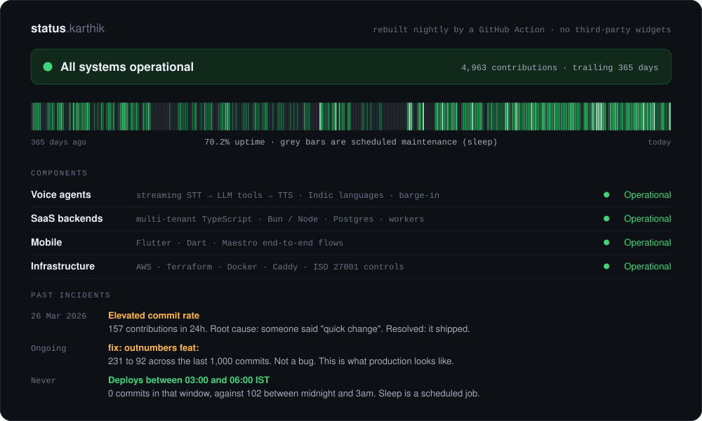

Everything above is rendered from scratch by <a href="src/render.py"><code>render.py</code></a>, which reads the GraphQL API every night at 04:17 IST, inside the three hours I have never once pushed code. No stats widgets, no shields, no third-party anything. Just one Python file and a long-standing grudge against <code>github-readme-stats</code>.

Private repos stay private: the Action stores counts, never names or messages. · <a href="https://github.com/karthikpms/aws-iso27001-toolkit">aws-iso27001-toolkit</a> · <a href="https://in.linkedin.com/in/karthik-sakthivel-6114a799">LinkedIn</a>
